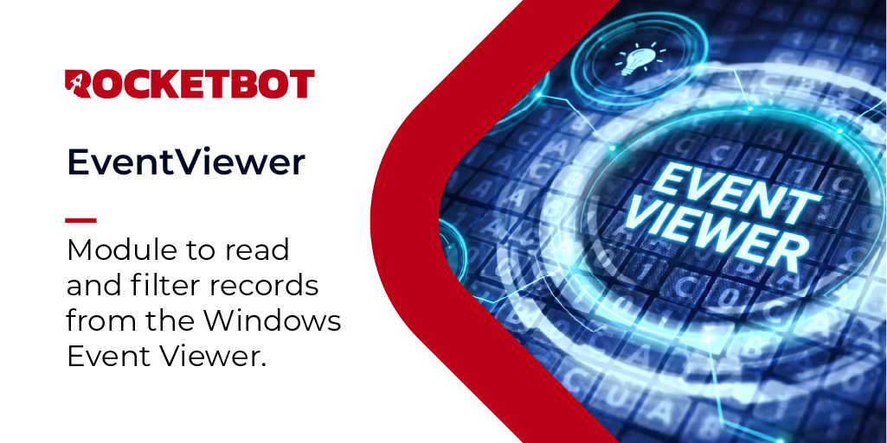

# Visualizador de Eventos do Windows
  
Módulo para ler e filtrar registros do Visualizador de Eventos do Windows.  

*Read this in other languages: [English](Manual_EventViewer.md), [Português](Manual_EventViewer.pr.md), [Español](Manual_EventViewer.es.md)*

## Como instalar este módulo
  
Para instalar o módulo no Rocketbot Studio, pode ser feito de duas formas:
1. Manual: __Baixe__ o arquivo .zip e descompacte-o na pasta módulos. O nome da pasta deve ser o mesmo do módulo e dentro dela devem ter os seguintes arquivos e pastas: \__init__.py, package.json, docs, example e libs. Se você tiver o aplicativo aberto, atualize seu navegador para poder usar o novo módulo.
2. Automático: Ao entrar no Rocketbot Studio na margem direita você encontrará a seção **Addons**, selecione **Install Mods**, procure o módulo desejado e aperte instalar.  

## Descrição do comando

### Obter eventos do Windows
  
Lê e filtra registros do Visualizador de Eventos do Windows.
|Parâmetros|Descrição|exemplo|
| --- | --- | --- |
|Log|Selecione o log do Windows que deseja ler. Segurança pode exigir permissões de administrador.|Selecione o log|
|Origem contém|Filtra eventos cujo nome de origem contém este texto.|Opcional|
|ID do evento|Filtra por um ID de evento exato.|Opcional|
|Tipo de evento|Selecione o tipo de evento que deseja incluir nos resultados.|Selecione o tipo de evento|
|De (DD/MM/AAAA HHmmss)|Inclui eventos gerados a partir desta data e hora.|14/10/2026 10:57:15|
|Até (DD/MM/AAAA HHmmss)|Inclui eventos gerados até esta data e hora.|14/10/2026 10:57:15|
|Mensagem contém|Filtra eventos cuja mensagem contém este texto.|Opcional|
|Máximo de registros a verificar|Número máximo de registros verificados, começando pelos mais recentes. Padrão 1000.|1000|
|Atribuir resultado à variável|Variável onde os resultados do log de eventos serão armazenados.|event_logs|
